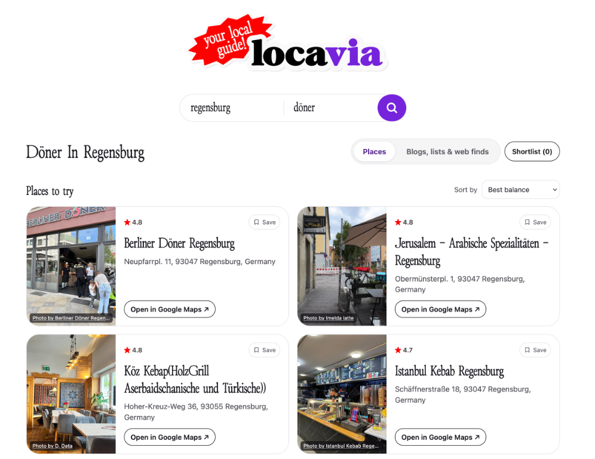
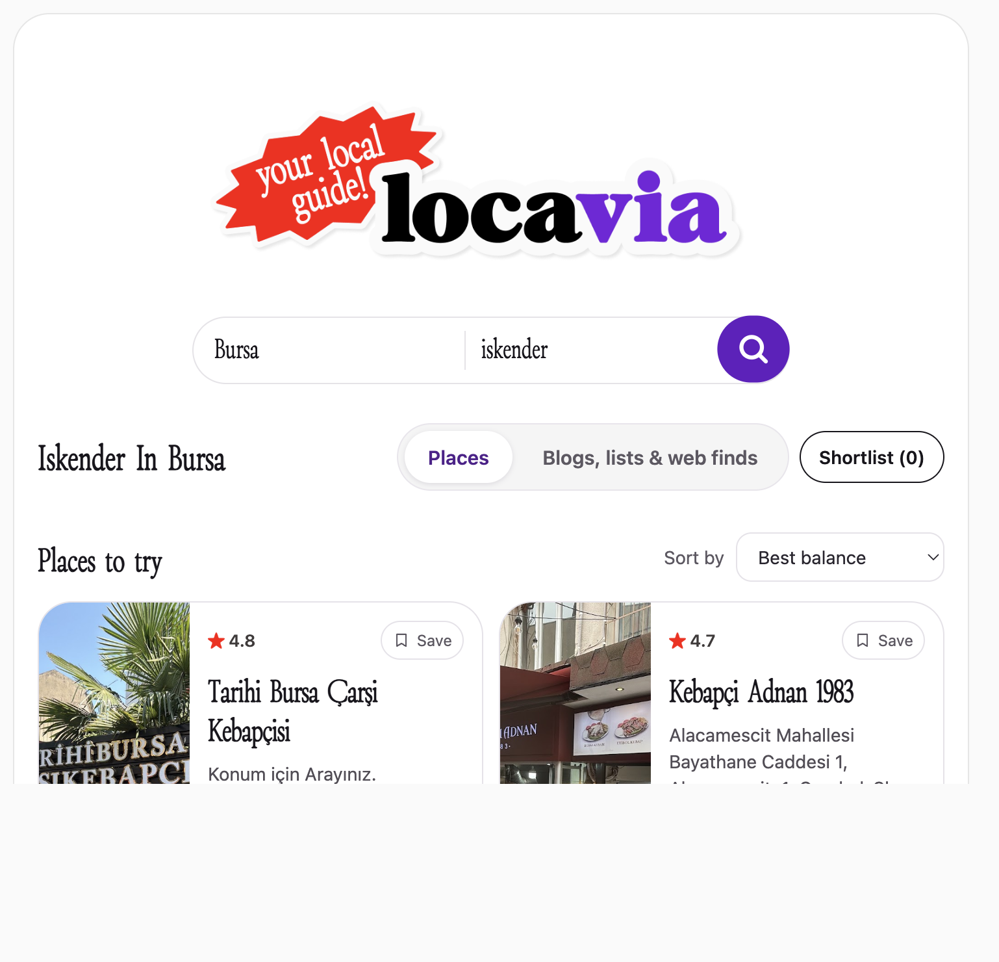
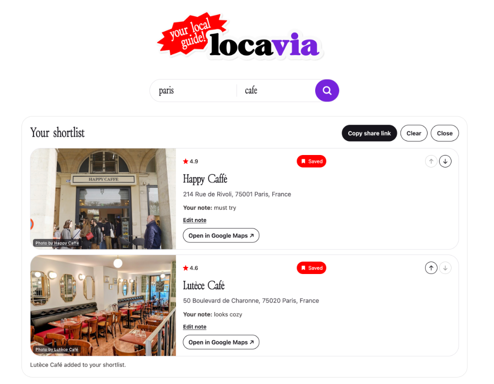
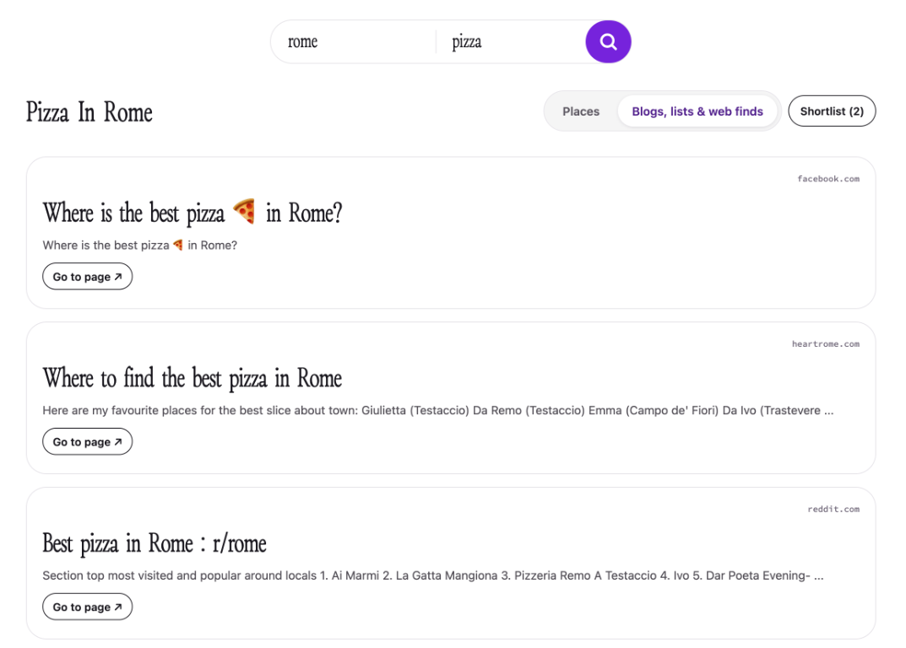

# Locavia

Locavia helps you find places to eat, spots to hang out, and things to do in a new city. I made it to learn how an app can use cloud services, store data, and bring information together from different sources.

Try it on the [live site](https://project-59870267-0ffe-40cc-800.web.app).

Search for a place or browse web guides and local recommendations. You can save up to five places, add notes, arrange your list, and share it with a link. Saved lists stay in your browser.

## A few examples

Here are place searches for döner in Regensburg and iskender in Bursa.





You can save places and add notes to your shortlist.



The web results tab shows guides, lists, and local recommendations.



## What it uses

React and Vite make the site. The backend uses Node and Express. Google Maps helps find places, SerpApi finds web guides, and Firestore stores search history. The site is on Firebase Hosting and the backend runs on Cloud Run.

## Run it on your computer

You need Node, a Google Cloud project, and API keys for Google Maps and SerpApi. Put the keys and project ID in `backend/.env`:

```env
GOOGLE_MAPS_API_KEY=your_key
GOOGLE_CLOUD_PROJECT=your_project_id
ENABLE_SERPAPI=true
SERPAPI_KEY=your_key
```

Sign in to Google Cloud with `gcloud auth application-default login`, then start the backend:

```bash
cd backend
npm install
npm start
```

In another terminal, start the site:

```bash
cd frontend
npm install
npm run dev
```

Open `http://localhost:5173`.

## Cloud demo

The public demo allows up to 20 searches and 100 photo requests per UTC day, shared by everyone. It also allows up to 60 API requests per minute. Usage may still incur charges, and the monthly billing alert is a notification, not a spending cap.
